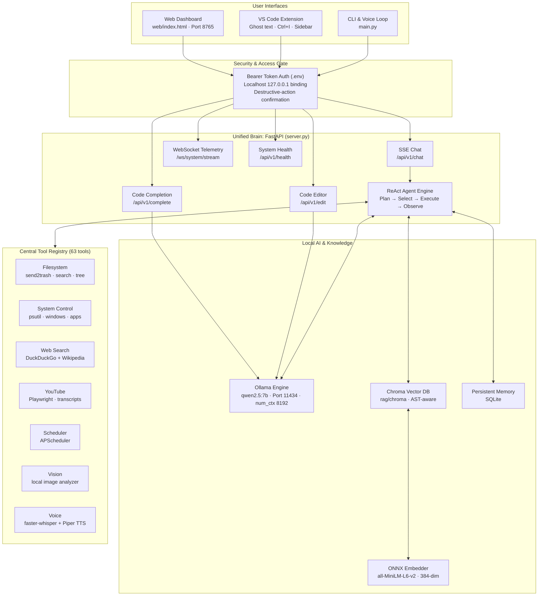

# JARVIS — Fully Local Autonomous AI Assistant & Copilot


JARVIS is an autonomous, private, and fully local personal AI assistant and development copilot built for **Windows 11**. It runs without any external paid APIs, using local [Ollama](https://ollama.com) models (`qwen2.5:7b`), pure offline ONNX embeddings (`all-MiniLM-L6-v2`), and real operating-system hooks.

---

## Key Features

- **Unified Brain (`server.py`)** — High-performance FastAPI server providing Server-Sent Events (SSE) chat streaming, fill-in-the-middle code completion, code diff generation, and WebSocket telemetry.
- **Full PC Control & Monitoring (63 tools)** — Direct Windows management via `psutil`, `pyautogui`, and `pywin32`. A background telemetry thread samples CPU, RAM, GPU, disk, network, and top processes every 2 seconds.
- **Safety by default** — Localhost (`127.0.0.1`) binding protected by an auto-generated Bearer token stored in `.env`. File deletion is routed through `send2trash` (Recycle Bin).
- **Pure offline ONNX RAG** — AST-aware, function-level code and document indexer using ChromaDB and a zero-dependency local ONNX embedder (384-dim).
- **Live internet & YouTube automation** — Multi-provider web search (DuckDuckGo with Wikipedia summary fallback) and Playwright Chromium automation with YouTube player controls and transcript Q&A.
- **Dark HUD web dashboard (`web/index.html`)** — Real-time token streaming, Markdown rendering with copy-to-clipboard code blocks, live telemetry graphs, and tool execution timelines.
- **VS Code extension (`jarvis-ai-copilot-1.1.0.vsix`)** — Native IDE companion with GitHub Copilot-style ghost-text inline completions, Inline Chat (`Ctrl+I`), a Webview chat sidebar, and a status bar one-click launcher.

---

## System Architecture



---

## Quickstart

### 1. One-click launch (recommended)

Double-click `start_jarvis.bat` in the project root, or run:

```bat
start_jarvis.bat
```

The launcher will:

1. Verify the Python 3.14 virtual environment.
2. Ensure the Ollama background daemon is running and `qwen2.5:7b` is loaded.
3. Start the unified backend (`server.py`) on `http://127.0.0.1:8765`.
4. Open the dark-mode HUD dashboard in your default browser.

### 2. Manual launch

```powershell
# Activate the virtual environment
.\venv\Scripts\Activate.ps1

# Start the unified backend server
python server.py
```

Then open:

| Page | URL |
|------|-----|
| Web Dashboard | <http://127.0.0.1:8765/> |
| Interactive OpenAPI Docs | <http://127.0.0.1:8765/docs> |
| Subsystem Health Check | <http://127.0.0.1:8765/api/v1/health> |

---

## VS Code Extension Installation

The compiled extension package is bundled in `jarvis-vscode-extension/`:

```bash
code --install-extension jarvis-vscode-extension/jarvis-ai-copilot-1.1.0.vsix
```

**Extension features**

- **Ghost-text inline completion** — Multi-line suggestions appear in gray as you type; press `Tab` to accept.
- **Inline Chat (`Ctrl+I`)** — Highlight a block of code and press `Ctrl+I` to refactor, explain, or edit it.
- **Sidebar chat panel** — Full conversation UI with JARVIS inside your editor sidebar.
- **Status bar integration** — Shows live server connection state; click to launch or reconnect.

---

## API Reference (`/api/v1`)

| Method | Endpoint | Description | Auth Required |
|--------|----------|-------------|---------------|
| GET | `/api/v1/health` | Comprehensive subsystem status check | No |
| POST | `/api/v1/chat` | ReAct streaming agent loop (Server-Sent Events) | Optional (localhost) |
| POST | `/api/v1/complete` | Low-latency fill-in-the-middle code completion | Yes (Bearer) |
| POST | `/api/v1/edit` | Structured code patch / diff generator | Yes (Bearer) |
| GET | `/api/v1/tools` | List all 63 registered tools with JSON schemas | Yes (Bearer) |
| POST | `/api/v1/tools/{name}` | Execute a specific registered tool | Yes (Bearer) |
| GET | `/api/v1/system/stats` | Real-time CPU, RAM, GPU, disk, network metrics | No |
| WS | `/ws/system/stream` | Continuous 2-second telemetry WebSocket stream | No |
| POST | `/api/v1/rag/query` | Query indexed code and documents | Yes (Bearer) |
| POST | `/api/v1/rag/index` | Re-index the repository or custom folders | Yes (Bearer) |

---

## Verification & Test Results

The quality and capability evaluation suite (`tests/eval_quality.py`) verifies all 31 core capabilities across 6 categories:

```bash
python tests/eval_quality.py
```

| Category | Passed | Result |
|----------|--------|--------|
| General Knowledge | 5 / 5 | 100% |
| Math & Logic | 5 / 5 | 100% |
| Coding & Algorithms | 5 / 5 | 100% |
| Web Search & Weather | 5 / 5 | 100% |
| PC Control & Automation | 6 / 6 | 100% |
| Tool Registry | 5 / 5 | 100% |
| **Overall** | **31 / 31** | **100.0%** |

Detailed execution transcripts and evidence logs are in [`docs/VERIFICATION.md`](docs/VERIFICATION.md).

---

## Security & Protective Safeguards

- **Localhost restriction** — By default `server.py` binds only to `127.0.0.1`, so other machines on the network cannot reach system-control endpoints.
- **Bearer token authentication** — Each session generates or reads a cryptographic secret from `.env` (`JARVIS_TOKEN`).
- **Safe file removal** — Deletions use `send2trash` instead of permanent unlinks, so accidental deletions can be restored from the Windows Recycle Bin.
- **Destructive-action interceptor** — When `REQUIRE_CONFIRMATION_FOR` is enabled, sensitive actions (reboots, process termination, bulk removals) require explicit operator approval.

---

## License

Released under the MIT License — see [`LICENSE`](LICENSE). *(Update this if you use a different license.)*
