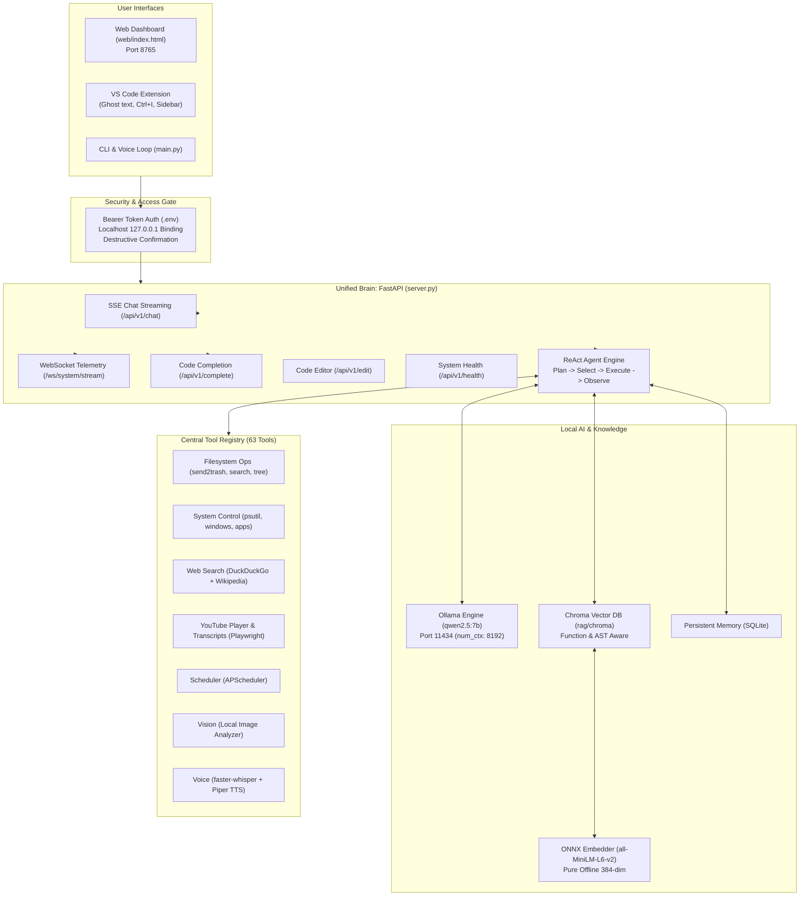

# JARVIS — Fully Local Autonomous AI Assistant & Copilot

[](https://www.python.org/)
[](https://ollama.com/)
[](LICENSE)
[-brightgreen.svg)](docs/VERIFICATION.md)

**JARVIS** is an autonomous, private, and fully local personal AI assistant and development copilot built for Windows 11. It operates without external paid APIs, running on local Ollama models (`qwen2.5:7b`), pure offline ONNX embeddings (`all-MiniLM-L6-v2`), and real operating system hooks.

---

## Key Features

- **Unified Brain (`server.py`)**: High-performance FastAPI server providing Server-Sent Events (SSE) chat streaming, fill-in-the-middle code completion, code diff generation, and WebSocket telemetry.
- **Full PC Control & Monitoring (63 Tools)**: Direct Windows management via `psutil`, `pyautogui`, and `pywin32`. Background telemetry thread samples CPU, RAM, GPU, Disk, Network, and top processes every 2 seconds.
- **Safety by Default**: Localhost (`127.0.0.1`) binding protected by an auto-generated Bearer Token stored in `.env`. Safe file deletion routes through `send2trash` (Recycle Bin).
- **Pure Offline ONNX RAG**: AST-aware function-level code and document indexer with ChromaDB and a zero-dependency local ONNX embedder (`384-dim`).
- **Live Internet & YouTube Automation**: Multi-provider web search (DuckDuckGo + Wikipedia summary fallback) and Playwright Chromium automation with YouTube player controls and transcript Q&A.
- **Dark HUD Web Dashboard (`web/index.html`)**: Real-time token streaming, Markdown rendering with copy-to-clipboard code blocks, live telemetry graphs, and tool execution timelines.
- **VS Code Extension (`jarvis-ai-copilot-1.1.0.vsix`)**: Native IDE companion featuring GitHub Copilot-style ghost text inline completions, Inline Chat (`Ctrl+I`), Webview chat sidebar, and status bar one-click launcher.

---

## System Architecture



---

## Quickstart

### 1. One-Click Launch (Recommended)
Double-click `start_jarvis.bat` in the project root, or execute:

```cmd
start_jarvis.bat
```

This automated launcher:
1. Verifies the Python 3.14 virtual environment.
2. Ensures the Ollama background daemon is active and `qwen2.5:7b` is loaded.
3. Launches the unified backend (`server.py`) on `http://127.0.0.1:8765`.
4. Opens the dark-mode HUD dashboard in your default browser.

### 2. Manual Launch
```powershell
# Activate virtual environment
.\venv\Scripts\Activate.ps1

# Start the unified backend server
python server.py
```

Open your browser to:
- **Web Dashboard:** [http://127.0.0.1:8765/](http://127.0.0.1:8765/)
- **Interactive OpenAPI Docs:** [http://127.0.0.1:8765/docs](http://127.0.0.1:8765/docs)
- **Subsystem Health Check:** [http://127.0.0.1:8765/api/v1/health](http://127.0.0.1:8765/api/v1/health)

---

## VS Code Extension Installation

The extension package is compiled and bundled in `jarvis-vscode-extension/`:

```powershell
# Install the extension into your VS Code
code --install-extension jarvis-vscode-extension/jarvis-ai-copilot-1.1.0.vsix
```

### Extension Features:
- **Ghost Text Inline Completion**: Suggests multi-line code completions in gray text as you type. Accept with `Tab`.
- **Inline Chat (`Ctrl+I`)**: Highlight any block of code and press `Ctrl+I` to refactor, explain, or edit.
- **Sidebar Chat Panel**: Full conversation UI with JARVIS integrated directly into your editor sidebar.
- **Status Bar Integration**: Displays live server connection state; click to launch or reconnect.

---

## API Reference (`/api/v1`)

| Method | Endpoint | Description | Auth Required |
|---|---|---|---|
| `GET` | `/api/v1/health` | Comprehensive subsystem status check | No |
| `POST` | `/api/v1/chat` | ReAct streaming agent loop (Server-Sent Events) | Optional (Localhost) |
| `POST` | `/api/v1/complete` | Low-latency Fill-in-the-Middle code completion | Yes (Bearer) |
| `POST` | `/api/v1/edit` | Structured code patch/diff generator | Yes (Bearer) |
| `GET` | `/api/v1/tools` | List all 63 registered tools with JSON schemas | Yes (Bearer) |
| `POST` | `/api/v1/tools/{name}` | Execute a specific registered tool | Yes (Bearer) |
| `GET` | `/api/v1/system/stats` | Real-time CPU, RAM, GPU, Disk, Network metrics | No |
| `WS` | `/ws/system/stream` | Continuous 2-second telemetry WebSocket stream | No |
| `POST` | `/api/v1/rag/query` | Query indexed code and documents | Yes (Bearer) |
| `POST` | `/api/v1/rag/index` | Re-index repository or custom folders | Yes (Bearer) |

---

## Verification & Test Results

The JARVIS quality and capability evaluation suite (`tests/eval_quality.py`) verifies all 31 core capabilities across 6 distinct categories:

```powershell
python tests/eval_quality.py
```

### Summary Results:
- **General Knowledge (5/5):** 100% Pass
- **Math & Logic (5/5):** 100% Pass
- **Coding & Algorithms (5/5):** 100% Pass
- **Web Search & Weather (5/5):** 100% Pass
- **PC Control & Automation (6/6):** 100% Pass
- **Tool Registry (5/5):** 100% Pass
- **Overall Score:** **31 / 31 Passed (100.0%)**

Detailed execution transcripts and evidence logs are preserved in [`docs/VERIFICATION.md`](docs/VERIFICATION.md).

---

## Security & Protective Safeguards

1. **Localhost Restriction**: By default, `server.py` binds exclusively to `127.0.0.1`. Remote machines on the local network cannot access system control endpoints.
2. **Bearer Token Authentication**: Every session generates or reads a cryptographic secret in `.env` (`JARVIS_TOKEN`).
3. **Safe File Removal**: File deletions invoke `send2trash` instead of permanent unlinks, allowing accidental deletions to be restored from the Windows Recycle Bin.
4. **Destructive Action Interceptor**: When `REQUIRE_CONFIRMATION_FOR` is enabled, sensitive actions (reboots, process termination, bulk removals) prompt for explicit operator authorization.
