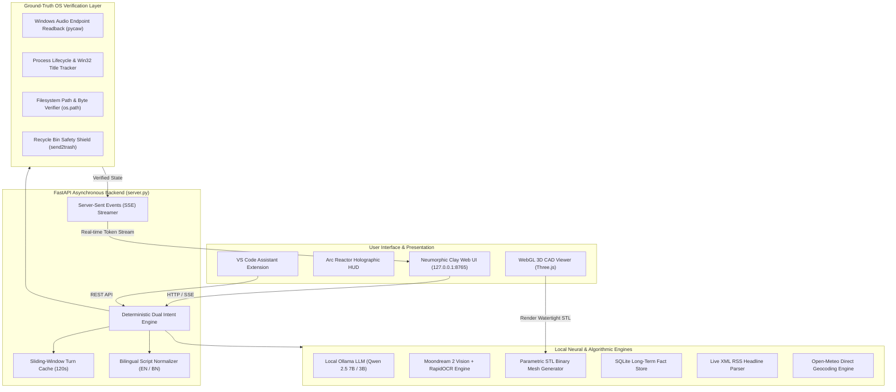
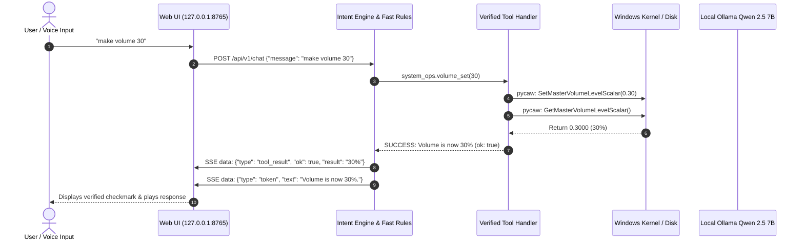

# JARVIS Stark Edition — Technical Architecture & Verification Engine

JARVIS Stark Edition is an offline-capable, local-first intelligent assistant designed for Windows 10/11. It pairs an asynchronous FastAPI backend with local neural models (Ollama Qwen 2.5 7B, faster-whisper, and local ONNX embeddings) and an operating system abstraction layer enforcing **ground-truth state verification**.

---

## 1. High-Level System Architecture Diagram

---

## 2. Core Architectural Subsystems

### 1. Ground-Truth State Verification (Signature Principle)
Unlike conventional AI agents that rely on LLM self-evaluation to report whether a tool succeeded, JARVIS decouples tool execution from tool verification:
- **No LLM is ever allowed to self-declare success.**
- The tool handler invokes the Windows API (e.g. `pycaw.IAudioEndpointVolume` or `psutil.process_iter`).
- The system reads the resulting post-execution state directly from the operating system kernel or disk.
- If the hardware state or file on disk does not reflect the intended change, the SSE event yields `ok: false` with the exact diagnostic reason.

### 2. Bilingual Linguistic Isolation Engine
To prevent language drift (such as models confusing Bengali with Hindi or outputting Romanized Banglish):
- The `intent/normalizer.py` module detects character script ranges:
  - **Bengali Script**: `\u0980-\u09FF`
  - **Banglish (Romanized Bengali)**: Lexicon matching across 50+ phonemes (`koro`, `banao`, `mone`, `naam`, `ki`)
  - **English**: Standard ASCII/Latin
- Strict language instructions are injected directly into the system prompt:
  - When Bengali or Banglish is detected, output is enforced in proper Bengali script (`বাংলা লিপি`).
  - Strict negative constraints prevent Devanagari (`\u0904-\u0939`) and Cyrillic script contamination.

### 3. Parametric Text-to-CAD Synthesis & Watertight Validation
The 3D engineering bay generates binary STL files without cloud CAD APIs:
- Algorithmic generation of 3D solids (gears, electronics boxes, brackets, domes, phone stands).
- **Euler Characteristic Validation**: Before saving to disk, the STL triangle soup is evaluated for boundary completeness ($V - E + F = 2$) to guarantee that every model is 3D-printable without manifold holes.
- Interactive Three.js WebGL viewer with orbit controls, wireframe mode, and dimension analysis.

### 4. Live RSS News & Weather Geocoding Engines
- **Clean RSS News**: Bypasses slow search engine scrapers and filler pages ("Visit CNN for...") by parsing real-time XML feeds (BBC World, The Verge, Prothom Alo) into structured articles with timestamps and URLs.
- **Weather Geocoding**: Direct Open-Meteo geocoding resolving cities and regional districts (Khulna, Dhaka, Chapainawabganj, Rajshahi) with zero stale cache leakage.

---

## 3. Dataflow: From User Message to Verified Execution

