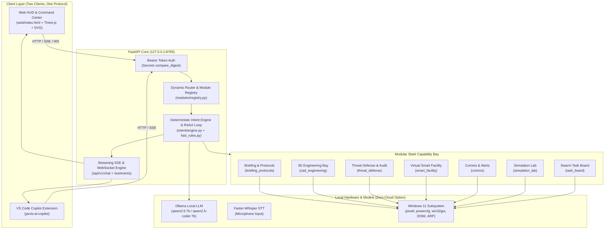

# JARVIS Stark Edition - System Architecture

JARVIS is a local-first, privacy-respecting AI assistant running on Windows with an autonomous modular capability framework, deterministic verified tool execution, and an international showcase civilian defense interface.

## Architectural Tenets

1. **Local-First & Offline Capable**:
   Core intelligence, file operations, hardware telemetry, 3D CAD modeling, threat audits, simulations, and smart room automation execute 100% locally on a standard 16 GB laptop without internet connection.
2. **Zero False Positives**:
   A tool result is marked success only when the real physical or operating system state confirms it (e.g. file size on disk, active power scheme GUID, volume scalar).
3. **Defensive Civilian Scope**:
   All security capabilities are strictly defensive (Windows Defender audit, firewall status, BitLocker, passive ARP table discovery with explicit user consent). Zero offensive probing or weapon systems.
4. **Plug-and-Play Dynamic Modules**:
   Modules live in `modules/` with self-describing `manifest.json` files, lazy-loaded routers, isolated tools, and health endpoints.

