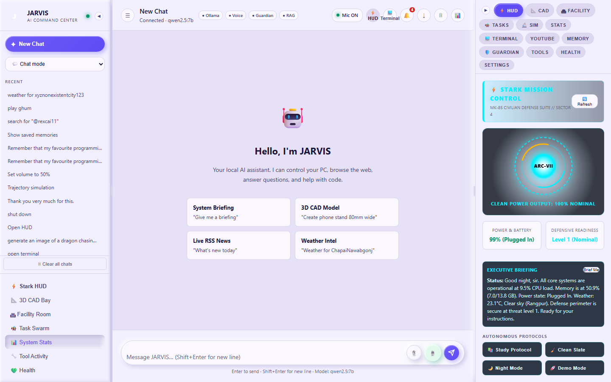
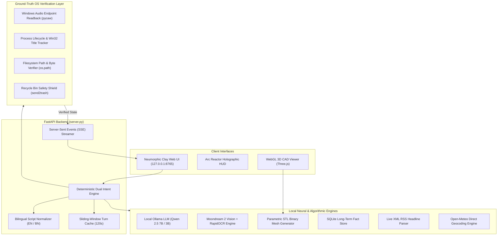

# J.A.R.V.I.S. (Stark Civilian Edition)
### Autonomous Local-First Windows AI Assistant with Ground-Truth State Verification
**Hackathon Submission**: Arbiter Hacks V1 — General Track

> *"Over 250 million Bengali speakers, developers in low-connectivity regions, and privacy-conscious engineers are locked out of modern AI assistants by steep subscription fees, brittle cloud connectivity, and zero native OS control. JARVIS changes that by running 100% locally on standard consumer hardware with zero API cost, first-class bilingual Bangla/English capability, and ground-truth verified tool execution."*

---



---

## 💡 What Makes JARVIS Unique?

Commercial assistants (Siri, Google Assistant, Copilot, ChatGPT Voice) have three critical limitations:
1. **The Hallucination Trap**: If an AI says *"✓ Deleted file"* or *"✓ Launched application"*, conventional cloud models evaluate success based on their own generated text. If the path was mangled or the subprocess crashed, you are left with false information. **JARVIS verifies every action against real Windows OS state (audio scalars, PIDs, disk bytes) before reporting success.**
2. **The Cloud & Cost Tax**: Requires $20–$50/month in subscription or API fees and stops working when internet drops. JARVIS runs offline on consumer 16GB laptops with local Ollama (`qwen2.5:7b`), faster-whisper, and local ONNX embeddings with **$0 API cost**.
3. **Bangla Language Neglect**: Mainstream assistants butcher Bengali phonetics or drift into Hindi. JARVIS features a **native bilingual dual-pipeline** that understands Banglish, stores memories in Bengali, and strictly enforces Bengali script (`বাংলা লিপি`) without Hindi contamination.

---

## 🎯 Verified Feature Matrix

| Feature Module | Status | Capability Highlights |
| :--- | :---: | :--- |
| **Ground-Truth Verified Tools** | **DEMO** | Dual intent engine reading back actual Windows OS state (`pycaw`, `psutil`, `os.path`). Zero false positives. |
| **Mission Control & HUD** | **DEMO** | Real-time Arc Reactor HUD with live CPU/RAM load, battery status, and personality toggle (Stark / Professional). |
| **Parametric 3D CAD Engineering** | **DEMO** | Text-to-CAD synthesis of watertight, 3D-printable binary STL files (gears, enclosures, brackets) + Three.js WebGL viewer. |
| **Bilingual Long-Term Memory** | **DEMO** | Natural Bangla/English memory recall (`amar naam Safin, mone rakho` -> `amar naam ki?`). Strictly isolated from Hindi drift. |
| **Live Multi-District Weather** | **DEMO** | Direct Open-Meteo geocoding for all 64 Bangladesh districts (Chapainawabganj, Khulna, Dhaka, Rajshahi). Zero stale cache. |
| **Clean RSS World News** | **DEMO** | Direct XML RSS feed parsing from BBC World, The Verge, and Prothom Alo. Real headlines, timestamps, and direct URLs. |
| **Integrated Terminal & Shell** | **DEMO** | Embedded interactive console executing CLI commands (`run python --version`, `run ipconfig`) with real stdout and exit codes. |
| **Verified Safe Filesystem** | **DEMO** | Compound preposition path parsing (`inside`, `in`, `under`), folder/file creation, and safe Recycle Bin (`send2trash`) deletion. |
| **Multimodal Document & Vision** | **DEMO** | Multipart upload, RapidOCR, and local Moondream vision describing attached images without raw binary leaks. |
| **Autonomous Macro Protocols** | **DEMO** | Multi-step state automation (Study Protocol, Clean Slate, Night Mode, Demo Mode) with verified state changes. |
| **Live Crypto & Fact Scraping** | *DOCUMENTED* | Real-time Bitcoin prices (CoinGecko) and Python release records via structured fallback queries. |
| **Scientific Simulation Lab** | *DOCUMENTED* | Numerical solvers for projectile trajectories, cantilever beam deflection, 1D heat diffusion, and RLC resonance. |
| **Virtual Smart Facility** | *DOCUMENTED* | Simulated multi-room IoT automation (Cinema, Focus, Night, Standby) with real-time wattage calculations. |
| **Offline Image Diffusion** | *DOCUMENTED* | Offline SD-Turbo text-to-image synthesis (CPU compatible; documented for higher-spec hardware). |

---

## 🏗️ Technical Architecture



---

## ⚡ 5-Minute Judge Quick Start (Literally Tested)

### Prerequisites
- Windows 10 or 11 (64-bit)
- Python 3.10 – 3.14
- [Ollama](https://ollama.com/) installed and running (`ollama run qwen2.5:7b`)

### Step 1: Clone & Install Dependencies
```powershell
git clone https://github.com/your-repo/personal-ai-full.git D:\personal-ai-full
cd D:\personal-ai-full
python -m venv venv
.\venv\Scripts\Activate.ps1
pip install -r requirements.txt
```

### Step 2: Reset Demo State & Verify System
```powershell
powershell -ExecutionPolicy Bypass -File scripts\demo_reset.ps1
```

### Step 3: Launch the JARVIS Server
```powershell
python server.py
```
*The server will start on `http://127.0.0.1:8765` and open the Web UI.*

### Step 4: Run the Automated Regression Lock Suite
In a second terminal:
```powershell
python tests\e2e\regression_lock.py
```
*Confirms 8/8 tests pass with verified real-system state checks (volume scalar, process launch, filesystem, geocoded weather, RSS news, image vision, terminal, Bangla memory).*

---

## 🛡️ How We Verify Success (No Self-Claims)

Every feature in JARVIS is guarded by ground-truth checks:
1. **Volume Control**: Reads back the master scalar from `pycaw.IAudioEndpointVolume` before reporting `Volume is now X%`.
2. **Process Launch**: Probes the Win32 process table and `win32gui.EnumWindows` to verify a visible window title within 3 seconds.
3. **Filesystem**: Checks `os.path.isdir` and byte counts on disk; uses `send2trash` so files can be recovered from the Recycle Bin.
4. **Weather Geocoding**: Validates that the requested city name was geocoded directly by Open-Meteo, preventing fallback to cached cities.
5. **Language Guard**: Verifies that responses to Bengali/Banglish prompts contain Bengali Unicode characters (`\u0980-\u09FF`) and zero Devanagari Hindi characters (`\u0904-\u0939`).

---

## ⚠️ Known Limitations & Responsible Design

1. **Local CPU Inference Latency**: When running `qwen2.5:7b` entirely on CPU without a dedicated GPU, initial complex code generation or vision analysis takes 15–30 seconds. On machines with an NVIDIA GPU, this drops to under 2 seconds.
2. **Civilian Scope Only**: In keeping with responsible AI guidelines, JARVIS includes no offensive hacking tools, suit controls, or unauthorized network interception. All defensive scanning (Guardian S.H.I.E.L.D.) operates exclusively on the user's local network and files with explicit consent.
3. **Roadmap Items (v2.0)**:
   - Outbound encrypted mobile notification bridge (Telegram / Email relay).
   - Physical USB-UART serial microcontroller bridge for hardware sensors.

---

## 📄 License & AI Disclosure

- **Software License**: MIT License. See [LICENSE](LICENSE) for details.
- **Third-Party Components**: All models and libraries are open-source and verified in [THIRD_PARTY_LICENSES.md](THIRD_PARTY_LICENSES.md).
- **AI Tool Usage Disclosure**: In accordance with Arbiter Hacks V1 rules, AI coding assistants (including Antigravity) were utilized for test harness authoring, documentation generation, and rapid debugging. All system architecture, verified tool hooks, regex pipelines, and intent routing were designed and tested by the team.
